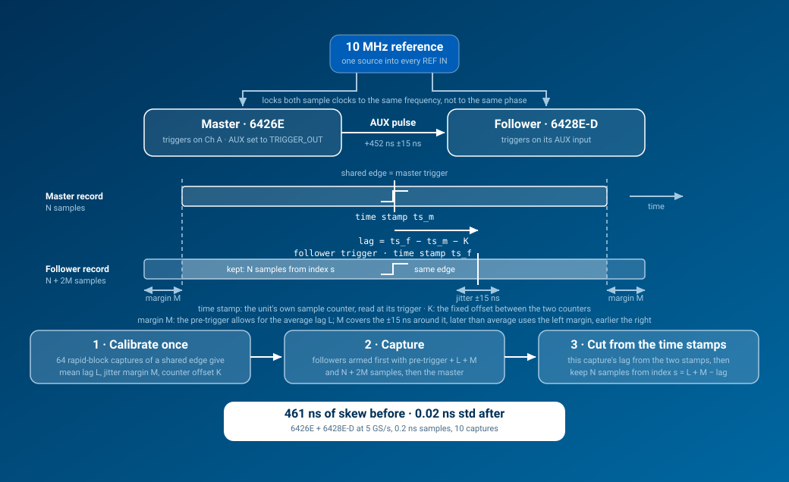

<!-- Copyright (C) 2025-2026 Pico Technology Ltd. See LICENSE file for terms. -->
# Multi-scope capture with PicoScope 6000E devices

`pypicosdk.MultiScope` drives two or more 6000E units as one instrument. The
10 MHz reference keeps every sample clock at the same frequency, the master's
AUX output triggers the followers, and the hardware trigger time stamps line
the records up sample for sample.

```python
import pypicosdk as psdk

group = psdk.MultiScope(["JR001/001", "JR001/002"])          # index 0 = master
group.open_unit()
group.set_channel(psdk.CHANNEL.A, range=psdk.RANGE.mV500, coupling=psdk.COUPLING.DC_50OHM)
group.set_siggen(frequency=1_000, pk2pk=1.8, wave_type=psdk.WAVEFORM.SQUARE)
group.set_simple_trigger(psdk.CHANNEL.A, threshold=0)         # master only
TIMEBASES = group.sample_rate_to_timebase(5, psdk.SAMPLE_RATE.GSPS)
group.calibrate(TIMEBASES)                                    # shared edge on Ch A of every scope
data, time_axis = group.run_simple_block_capture(TIMEBASES, 10_000)
data[1][psdk.CHANNEL.A]                                       # follower, on the master's time axis
group.close_unit()
```

Everything the group does not broadcast is still there per device:
`group[1].set_channel(...)` is the ordinary `ps6000a` API.

## Examples

| Script | Shows |
|---|---|
| `block_overlay.py` | The same edge on both scopes, before and after calibration. Each scope is set up through its own `ps6000a` object (`master.set_channel(...)`, `follower.set_channel(...)`); the group only opens, calibrates, captures and closes. Set `EXTERNAL_PULSE = True` to capture a single-shot pulse of your own on the same channel instead. |
| `rapid_block_skew.py` | Histograms of the raw AUX trigger lag and of what is left after time-stamp alignment, over 500 segments. |
| `reference_lock.py` | Live lock status from the driver's reference callback. Unplug a REF IN cable and watch. |
| `drift_locked_vs_unlocked.py` | Clock drift along a two-second record, locked versus on the follower's own crystal. |

Until this feature is on PyPI, run the examples against a checkout by putting
the checkout root on `PYTHONPATH` (a pip-installed pypicosdk would otherwise
shadow it). Once per terminal session:

```bat
:: Windows cmd
set PYTHONPATH=C:\path\to\pyPicoSDK
python examples\multiscope\block_overlay.py
```

```powershell
# Windows PowerShell
$env:PYTHONPATH = 'C:\path\to\pyPicoSDK'
python examples\multiscope\block_overlay.py
```

```bash
# Linux, macOS, Git Bash
PYTHONPATH=/path/to/pyPicoSDK python examples/multiscope/block_overlay.py
```

Every script starts with `SERIALS = psdk.MultiScope.discover()` and
`MASTER = None`. `discover()` lists the 6000E units in sorted serial order (the
driver's own enumeration order changes from run to run), which says nothing
about the cabling, and with `MASTER = None` the first of them is the master.
Set `MASTER` to the serial number of the unit whose AUX drives the others.
`psdk.MultiScope(serials, master="JR001/002")` moves that unit to index 0 and
keeps the followers in their listed order; `group.serials` shows the result.
With the roles swapped the AUX link still works, because the connector is
symmetric, but the AWG on the tee is then the follower's and
`group.set_siggen` drives the wrong one.

## Wiring

**With an external 10 MHz reference** (`REFERENCE = "external"`, the default):

```
 10 MHz reference --+--> master  REF IN (rear)
                    +--> follower REF IN (rear)      one lead per scope, or a tee

 master AUX I/O -------> follower AUX I/O            one BNC lead (tee to more followers)

 master AWG out --tee--> master  Ch A                equal-length leads, 50 ohm inputs
                     +-> follower Ch A
```

The 6000E REF IN is high impedance, AC coupled, and accepts 200 mV to 3.3 V
pk-pk. A 3.3 V CMOS square-wave source such as the Leo Bodnar LBE-1421 sits at
the top of that window into a high-impedance load; use its low-power mode or
a 50 ohm feedthrough terminator at the scope to bring it to 1.65 V.

**With the master AWG as the reference** (`REFERENCE = "master_awg"`):

```
 master AWG out -------> follower REF IN             10 MHz sine, 1 V pk-pk open circuit
 master AUX I/O -------> follower AUX I/O
 follower AWG out --tee--> master  Ch A              the follower's generator is the stimulus
                       +-> follower Ch A
```

The master AWG is clocked from the master's own timebase, so the follower
locks to the master. `group.set_siggen(...)` then drives the follower's AWG.

## How the alignment works



1. **Reference lock.** Every unit runs from the 10 MHz on its REF IN, so the
   sample clocks have the same frequency. Each unit's PLL still settles at its
   own phase, so there is a constant sub-sample offset between them.
2. **Trigger.** The master triggers on whatever you configure. Its AUX I/O is
   in TRIGGER_OUT mode, and every follower triggers on the rising edge at its
   AUX input. A forced (auto) trigger on the master reaches the followers too.
3. **Latency and jitter.** A follower triggers a fixed time after the master
   plus a jitter of tens of sample periods. On the bench pair used to develop
   this (6426E master, 6428E-D follower) the latency was about 3.3 µs at
   500 MS/s and 450 ns at 5 GS/s, with a spread of about 150 sample periods at
   both rates. Both numbers depend on the timebase.
4. **Time stamps.** Every capture carries a trigger time-stamp counter on each
   unit, counting sample periods: the `timeStampCounter` field of
   `PICO_TRIGGER_INFO`, read with `get_trigger_info()` after the data. (Not
   `GetTriggerTimeOffset`, which needs analog trigger data and is absent for an
   AUX-triggered follower.) With the reference locked, the difference
   between the follower's and the master's counters, minus the follower's
   actual lag, is a constant. `calibrate()` measures that constant from a
   shared edge; afterwards every capture's exact lag comes from the two time
   stamps, without any shared signal.
5. **Capture.** Followers are armed first with the mean latency plus a margin
   of extra pre-trigger samples, then the master. The margin covers the
   variation around the mean lag: a follower that fired later than average
   uses the margin at the start of its record, one that fired earlier uses
   the margin at the end. Each follower record is cut
   to the master's window at the position the time stamps give. Measured on
   the bench pair at 5 GS/s: 461 ns of skew before calibration, 0.02 ns
   standard deviation after, on 0.2 ns samples. At 500 MS/s: 3.2 µs before,
   0.3 ns after, on 3.2 ns samples.

## Calibration rules

- Enable channels, set the master trigger and pick the timebase first, then
  call `calibrate()` with the shared edge on the calibration channel of every
  scope. The signal period must be longer than the capture window.
- A calibration is valid for the timebase it was measured at. Capturing at
  another timebase raises `MultiScopeError`.
- The AUX latency also depends on which channels are enabled (on the bench
  pair it moved from 3.2 µs to 2.0 µs when a second channel came on), so
  calibrate with the channel set you will capture with.
- Changing the timebase or the master's trigger source restarts the
  time-stamp counters on the device. Channel range and coupling changes and
  re-applying the same trigger do not. A capture that sees a restart raises
  (or, with `strict=False`, warns and falls back to mean-latency alignment)
  until you calibrate again.
- The time-stamp offset is specific to the session: counters restart when a
  unit is opened. A calibration loaded from JSON gives latency-only alignment
  until `calibrate()` runs again.
- `group.last_alignment` records the lag, shift and sub-sample residual of the
  last capture. The residual is reported, not applied.
- Cable lengths. The AUX leads can be any length, and a different length to
  each follower: their delay is part of the latency `calibrate()` measures,
  and every capture takes its lag from the trigger time stamps anyway. The
  reference leads can differ too; they shift each unit's sample grid by a
  fixed amount, which the time-stamp offset absorbs. The leads from the tee to
  the calibration channels must match, because `calibrate()` assumes the edge
  reaches every scope at the same instant. Any difference becomes a fixed skew
  in every later capture, about 5 ns per metre of coax (1 cm is a quarter of
  a sample at 5 GS/s), and the spread `calibrate()` reports cannot show it.
  The alignment is exact at the point where the calibration edge splits, so
  calibrate through the leads you measure with where you can. Calibrate again
  after changing any cable.

## Troubleshooting

| Symptom | Cause and fix |
|---|---|
| `reference_status` shows `INTERNAL_REF` | No valid 10 MHz on that REF IN. Check the level (200 mV to 3.3 V pk-pk) and the cable. Captures still run, unlocked. |
| `calibrate()` reports no edge on a scope | The shared edge is not reaching that channel, or the window is too short to contain the follower's delayed copy of it. Use a tee with equal leads and at least 10 000 samples. |
| "cannot all sample at the same interval" | A mixed-model group asked for a rate one model cannot reach. Choose a rate every model supports. |
| "time-stamp counters restarted" | A setting changed after calibration. Call `calibrate()` again at the current settings. |
| A follower "missed a trigger" in rapid block | The master re-triggered before the follower re-armed (about 300 to 700 ns). Slow the trigger rate or reduce the segment count per run. |
| The 6428E-D rejects a range or coupling | It is 50 ohm only, ±50 mV to ±500 mV. Configure it with `group[i].set_channel(...)` rather than the broadcast. |
| A capture waits forever | `timeout_s=None` waits for the trigger indefinitely; Ctrl+C stops every scope cleanly. Pass a timeout to get a `MultiScopeError` instead. |
